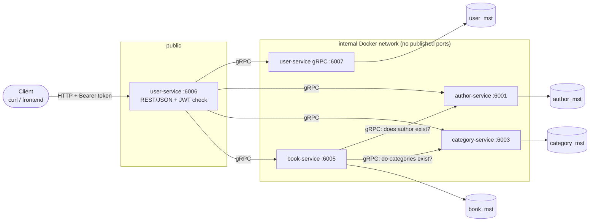
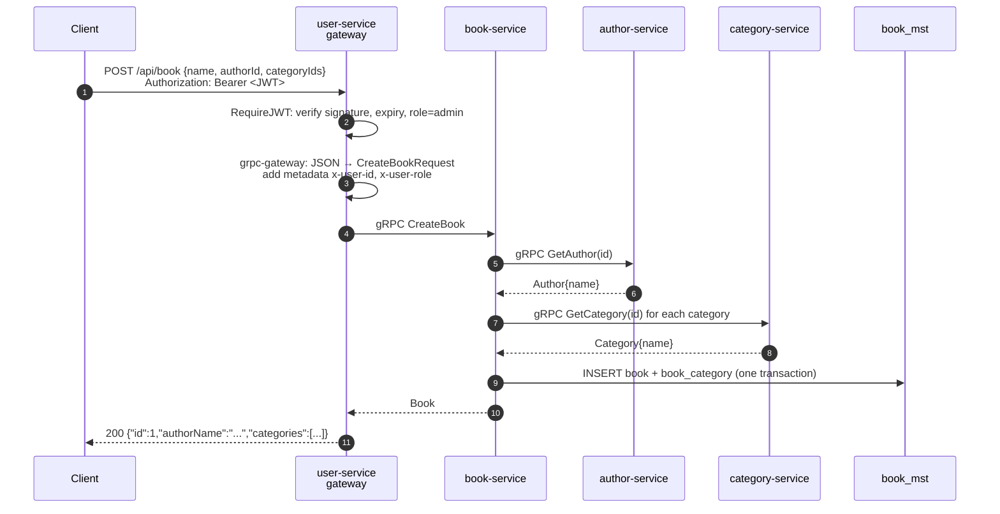
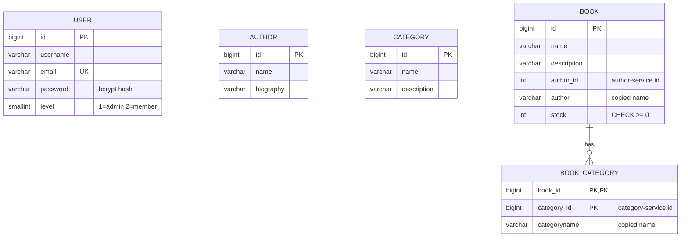

# Architecture

## The big picture

The system is four Go services. Each one owns one PostgreSQL database. Clients only ever talk
to **user-service**, which acts as the API gateway. Everything behind it uses gRPC.



| Service          | Owns                       | Talks to                    |
|------------------|----------------------------|-----------------------------|
| user-service     | users, login, JWT, gateway | all services (gateway)      |
| author-service   | authors                    | nothing                     |
| category-service | categories                 | nothing                     |
| book-service     | books, stock, book↔category links | author, category     |

## Why one gateway?

- **One place for security.** The JWT is checked once, at the edge. The internal services don't
  need the secret and don't repeat the check.
- **A small attack surface.** Only port 6006 is reachable. The databases and gRPC ports are not
  published (the database ports are published in `docker-compose.yml` only for local
  debugging).
- **REST outside, gRPC inside.** Browsers and curl speak JSON. Services talk to each other with
  gRPC, which is typed, faster, and generated from the same `.proto` contract. This pattern comes
  from [gRPC with REST and Open APIs](https://grpc.io/blog/coreos/).

## Life of a request

`POST /api/book` with an admin token:



If something fails, the error travels back the same way as a **gRPC status code**, and the
gateway turns it into an **HTTP status**:

| Where it fails | gRPC code | HTTP |
|---|---|---|
| no or invalid token (gateway) | `UNAUTHENTICATED` | 401 |
| member tries to write (gateway) | `PERMISSION_DENIED` | 403 |
| author or category doesn't exist (book-service) | `INVALID_ARGUMENT` | 400 |
| author-service is down (book-service) | `UNAVAILABLE` | 503 |
| book id not found | `NOT_FOUND` | 404 |
| stock would go below zero | `FAILED_PRECONDITION` | 400 |
| database error | `INTERNAL` | 500 (generic message) |

## Who the caller is: gRPC metadata

After verifying the token, the gateway adds two gRPC metadata entries. Metadata works like HTTP
headers for gRPC:

```
x-user-id:   42
x-user-role: member
```

Services read them with `metadata.FromIncomingContext(ctx)`. user-service's `GetCurrentUser`
uses them, and every service logs `user=<id>` per call.

Services **trust** these values without checking a token. That is only safe because:

1. the gateway removes any `Grpc-Metadata-*` header a client sends, so clients cannot set them
2. the gRPC ports are not reachable from outside

If you ever expose a gRPC port publicly, this trust breaks. That is why user-service serves gRPC
on a separate internal port (6007), not on the public one.

## Data ownership: no cross-database JOINs

Each service has its own database, so book-service **cannot** `JOIN author`. Instead it keeps a
copy of what it needs, taken when the book is saved:

| book_mst column | copied from |
|---|---|
| `book.author` (`AuthorName`) | author-service `Author.name` |
| `book_category.categoryname` | category-service `Category.name` |

Trade-off: reads are fast and still work while author-service is down, but if an author is
renamed, old books keep the old name until they are updated. This is a classic microservice
trade-off: **availability over immediate consistency**. A later improvement could push rename
events to book-service.

## Database design

See [`erd.png`](../erd.png) for the full planned ERD. The `CREATE TABLE` statements, with comments,
are in [`db/schema/`](../db/schema/). Implemented tables:



Every table except `BOOK_CATEGORY` also has `created_at`, `updated_at` and `deleted_at` from
`gorm.Model` (soft delete). `BOOK_CATEGORY` is a plain link table.
`USER`, `AUTHOR` and `CATEGORY` live in different databases, so the lines between services in
the ERD are logical links, not foreign keys.
